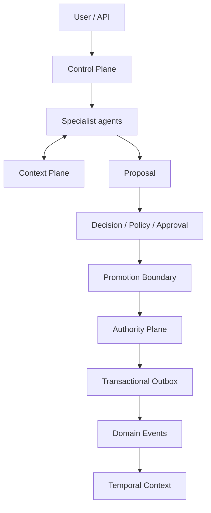

# CareOps Trust Gateway

Intelligence can be distributed. Authority should remain explicit.

CareOps is a synthetic healthcare-operations reference. Several specialist agents can inspect a governed metric, recall history, delegate, and propose a change. None of them can turn that belief into enterprise fact. Only the Authority Plane can, and only through an explicit promotion boundary.

The hiring question this repository answers:

> When probabilistic specialists can reason, delegate, remember, and propose, who is allowed to turn belief into fact?

The system answer: the governed Authority Plane, after a decision, a separate authorization check, and a version match.

The flagship metric stays a governed calculation: Texas / Aetna bookable appointments move from **42** in the prior week to **24** last week. A later promotion may record that provider `P002` became `inactive` on 2026-09-30. That transition is a domain event. It does not recalculate the metric.

---

## Four planes

| Plane | Holds | Does not hold |
|---|---|---|
| Authority | Governed data products, metric contracts, policies, and the committed domain row | Agent memory, proposals, or model output |
| Control | Workflows, task ownership, delegation, budgets, decisions, proposals, and the version gate | The right to write the metric or skip authorization |
| Execution | `DataQualityAgent`, `TemporalContextAgent`, `PolicyAgent` | Direct calls to each other, or a commit API |
| Context | The bounded ontology, `TemporalContextStore`, the Graphiti adapter, and episodes | Current metric truth or current policy |

These are boundaries, not synonyms:

- Persistence is not authority.
- Context is not truth.
- An agent finding is not a verified fact.
- A proposal is not a command.
- A decision is not authorization.
- A finished task is not a committed domain row.
- An event projection is not the source of truth.



The context copy of a committed event keeps `store_authority: false`. Graphiti sits behind `TemporalContextStore`. The qualified context implementation is the local deterministic store.

---

## Controlled workflow

One promotion, `careops.control.promotion.promote`, runs this path. The tests in `tests/test_promotion.py` are the inspectable demonstration.

1. The governed metric remains 42, then 24.
2. The workflow starts against authority version `0` for `provider:P002|network:Aetna`.
3. `DataQualityAgent` records an `OBSERVED` finding about the metric contract. It does not invent a new number.
4. `TemporalContextAgent` reads preceding episodes for `P002`. Its finding stays `INFERRED`.
5. That agent requests the capability `policy_interpretation`. It does not call `PolicyAgent`.
6. The control plane creates a child task assigned to `PolicyAgent`, with `delegation_depth` 1.
7. Findings are counted by distinct evidence root. A repeated claim on the same root is still one root.
8. A proposal is stored with `expected_entity_version` `0`. Approval here is ledger state. `domain_mutated` stays false.
9. `FixtureDecisionGate` evaluates the proposal. `REJECT` stops the path before any domain write.
10. `authorize` evaluates the actor. A `guest` is `unauthorized_role` and cannot commit.
11. `ChangeStore.commit_if_current` checks that the subject is still at version `0`.
12. On a match, the authority version moves `0` to `1` in the same transaction as the change row and the outbox row.
13. The event is `provider.network_status_changed`: `P002`, Aetna, `to_status` `inactive`, occurred 2026-09-30. The payload does not carry `42`, `24`, or `is_bookable`.
14. `project_episode` builds a `COMMITTED` episode. `COMMITTED` means the source transition was committed. The copy is not an authority.
15. A second workflow that still expects version `0` is classified `STALE` and does not write a second change. Replaying the same promotion key is idempotent.

Depth above the configured maximum stops before `PolicyAgent` runs and before any commit. Loop detection and model/tool budgets are enforced on the same control store (`tests/test_control.py`).

This is controlled delegation through the application control plane. It is not an implementation of the Google A2A protocol, and it is not a claim of protocol interoperability.

---

## Trusted data foundation

`available_appointments` is calculated only by `careops.metrics.get_metric`, described in `semantic/metrics.json`, and reviewed as DuckDB bronze, silver, and gold models under `dbt/`. Grain is `provider_id`, `slot_date`, `payer_network`, `state`. A naive join fanout is modeled separately and tested so it cannot be mistaken for the gold grain.

The public demo and `python -m careops.cli` still answer the flagship question from that metric. They do not consult the proposal ledger.

Synthetic inputs are providers, payer-network participation, and appointment slots. There is no real patient data.

---

## Identity and governance

`POST /v1/query` requires a verified local HS256 token. The request body cannot choose the role or the tenant. Cross-tenant calls are denied before retrieval. Analysts do not receive restricted credentialing text or raw provider names on that route. Field policy masks or drops those fields before the response is assembled.

The public demo path remains a role switch for the lean walkthrough. It is not the protected route.

---

## Freshness

Protected metric and mixed answers compare `semantic/source_freshness.json` with the demo clock. A source inside the freshness SLO can be answered. A source past the SLO returns `stale_evidence` and does not call the model or invent a number. A policy-only question can still be answered when the metric source is stale. `/health` is process liveness. `/ready` names the product.

---

## Contracts and replay

Core, REST, and CLI project one governed view of the same result: metric id, contract version, prior 42, current 24, as-of date, freshness, outcome. Replay compares a candidate contract with the baseline. An additive, versioned change can pass. An unversioned change to grain, access, or response shape fails closed.

```bash
python -m evals.replay --base evals/fixtures/replay/baseline.json --candidate evals/fixtures/replay/safe_additive.json
python -m evals.replay --base evals/fixtures/replay/baseline.json --candidate evals/fixtures/replay/unsafe_unversioned.json
```

The safe command exits 0. The unsafe command exits 1.

---

## Events

A domain change and its outbox row commit in one transaction. Delivery is at-least-once through an in-process broker. Consumers are idempotent. An older event stays in history and does not replace a newer current projection. An unsupported event version is dead-lettered. A down consumer leaves the commit in place. A down broker leaves the outbox pending and does not block `get_metric` or `POST /v1/query`.

The event interfaces are transport-neutral. Kafka, EventBridge, and similar systems are deployment choices. They are not qualified components of this build. Exactly-once delivery is not a claim.

---

## Temporal context

`TemporalContextStore` is the application boundary. CI uses `LocalTemporalStore` and `semantic/episodes.json`. `GraphitiTemporalStore` is the adapter. It is not imported by metric logic, policy logic, or the protected query, and it is not a health check.

Reference time, observed time, and effective dates stay distinct. A future-effective policy is absent from an earlier query and visible once the clock passes it. Superseded participation remains in history and is not treated as current. If the context store is down, the answer still returns 42 then 24 and says historical context is unavailable.

Temporal order is labeled as context. The narration says a change preceded later observations. It does not say the change caused the decline.

Graphiti integration is implemented behind `TemporalContextStore`, but the deterministic local temporal store is the qualified CI implementation. Live Graphiti service qualification was not executed for v0.4. The skipped test is `test_live_graphiti_service_was_not_executed`.

---

## Failure modes

| Area | What the suite shows | Where |
|---|---|---|
| Data | Naive fanout is detected. Gold grain reconciles to slots. | `dbt` tests `assert_naive_join_fans_out`, `assert_gold_reconciles_to_slots` |
| Identity | Bad tokens are rejected. Cross-tenant is denied. Restricted fields stay out of the analyst view. | `tests/test_identity.py` |
| Freshness | A stale source yields `stale_evidence` and does not retrieve. | `tests/test_ops.py` |
| Contracts | Unsafe unversioned drift fails replay. A versioned additive change passes. | `evals/replay.py` |
| Events | Duplicate delivery applies once. An older event does not regress current state. A down broker leaves the 42 to 24 path intact. | `tests/test_events.py` |
| Context | Future evidence is excluded. History survives supersession. An outage omits context and invents nothing. Adjacency is not causality. | `tests/test_context.py` |
| Control | Specialists do not call each other. Delegation is a child task. Same-root findings count as one root. A stale version, a rejected decision, and an unauthorized actor do not commit. Replay does not add a second change. Depth, budget, and loop limits stop in the control plane. | `tests/test_control.py`, `tests/test_promotion.py` |

---

## Decision gate

v0.4 qualifies a deterministic `FixtureDecisionGate`. Jev is a compatible future bounded-decision adapter concept, not a qualified dependency of this build. A gate result of `COMPLETE` does not authorize the actor and does not commit.

---

## Run locally

From a checkout, with Python 3.11 or newer:

```bash
python3 -m venv .venv
source .venv/bin/activate
pip install -e '.[dev,dbt]'
python -m careops.bootstrap
python -m careops.cli --role analyst \
  "Why did in-network appointment availability in Texas decline last week?"
python -m pytest -q
python -m evals.run
python -m evals.replay --base evals/fixtures/replay/baseline.json --candidate evals/fixtures/replay/safe_additive.json
python -m evals.replay --base evals/fixtures/replay/baseline.json --candidate evals/fixtures/replay/unsafe_unversioned.json
```

dbt, from `dbt/`:

```bash
export DBT_PROFILES_DIR="$PWD"
dbt seed && dbt build
```

The HTTP demo is `app/main.py`. `POST /api/demo` is the lean role switch. `POST /v1/query` is the protected route. Optional MCP tools, when the extra is installed, remain `get_metric`, `explain_metric`, `search_policy`, and `resolve_entity`. No API key is required for the qualified path.

---

## Deployment posture

Qualification of this branch is local: pytest, the eval harness, dbt on DuckDB, and the CLI. `docs/azure-deployment.md` is an existing reference profile for a disposable container and Postgres layout. It is not a claim that v0.4 was qualified on Azure, and this repository does not add a second cloud. Interfaces that are real in this tree — the metric tool, the outbox, and `TemporalContextStore` — can sit on other infrastructure later. That is portability of the boundary, not a multi-cloud deployment.

---

## Explicit non-claims

- No Google A2A protocol implementation or interoperability.
- No live Jev integration.
- No live Graphiti qualification. The skipped test is named above.
- No production-scale distributed orchestration, and no workflow product such as Temporal.
- No exactly-once event delivery.
- No causal claim from temporal order.
- No autonomous enterprise operation. Agents propose. The authority plane commits.
- No real patient data, and no employer-specific domain.

---

## Qualification record

Recorded from the local run of this documentation checkout. The HTTP demo was not started.

| Check | Result |
|---|---|
| pytest | 87 passed, 1 skipped, 0.49s |
| skipped | `test_live_graphiti_service_was_not_executed` — live Graphiti service is not part of CI and was not executed |
| evals | 7/7 passed |
| metric prior / current | 42 / 24 |
| dbt seed | PASS=3 WARN=0 ERROR=0 SKIP=0 |
| dbt build | PASS=41 WARN=0 ERROR=0 SKIP=0 |
| replay safe | exit 0, `ok: true`, additive `change_note` |
| replay unsafe | exit 1, `ok: false`, grain changed |
| CLI smoke | `status: ok`, route `mixed`, governed prior 42 / current 24, freshness `fresh`, outcome `allow` |

---

## Design principle

Models and specialists can reason about enterprise truth. They do not silently become the authority that defines it.
